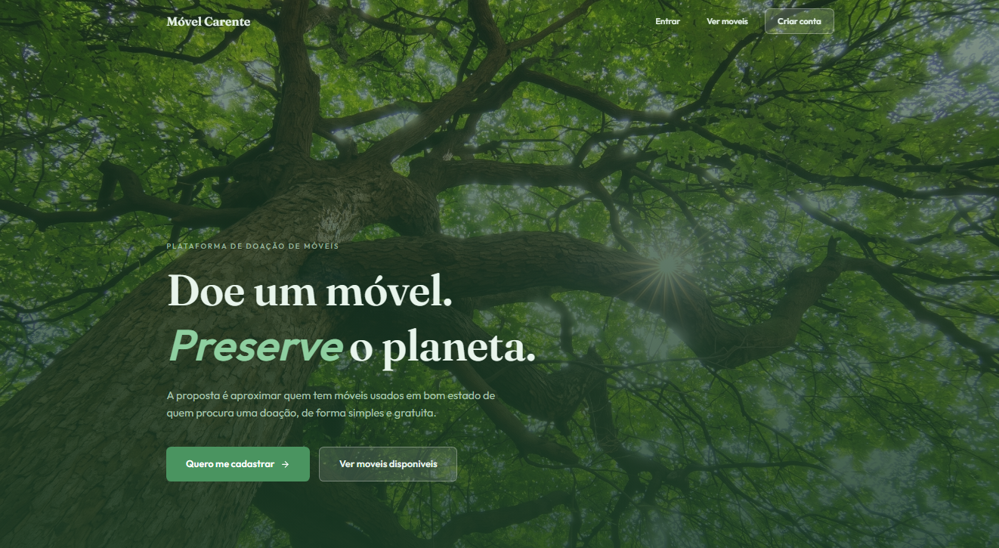
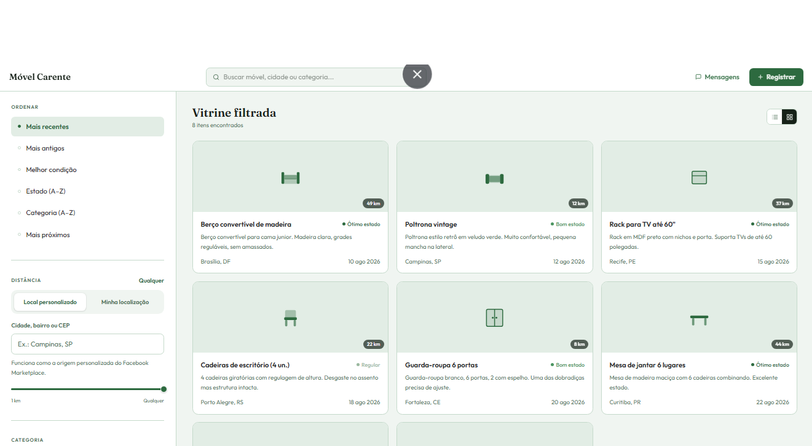
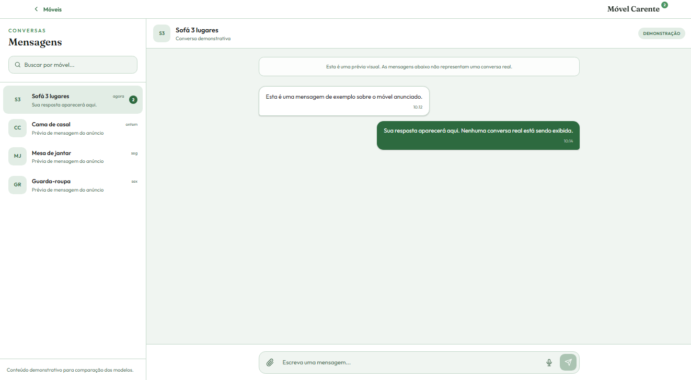

<div align="center">


&nbsp;&nbsp;&nbsp;&nbsp;

# MóvelCarente

**Plataforma de doação de móveis, eletrodomésticos e roupas, de pessoa pra pessoa.**

Quem tem algo parado em casa anuncia. Quem precisa solicita. Simples assim.


</div>

---

## Screenshots (Protótipos Via Figma)

<p align="center">
  
  
  
  
</p>

---

## Sobre o projeto

O **MóvelCarente** conecta **doadores**, que anunciam itens físicos, com **pessoas da comunidade**, que solicitam esses itens. Foi pensado pro mercado brasileiro: CPF/CNPJ, CEP com preenchimento automático, busca por proximidade e telefones no formato BR.

É um projeto pessoal de portfólio, construído de ponta a ponta (API, banco, tempo real, front-end e testes).

---

## Funcionalidades

- **Autenticação completa:** registro, login com bloqueio por tentativas erradas, refresh token com rotação e detecção de reuso, cookies httpOnly, recuperação de senha e verificação de e-mail
- **Cadastro com CPF ou CNPJ**, com validação oficial (incluindo CNPJ alfanumérico, IN RFB 2.229/2024)
- **Anúncios de itens:** CRUD, filtros, paginação, upload de até 10 imagens e máquina de estados (disponível → reservado → doado/cancelado)
- **Busca geográfica com PostGIS:** filtro por raio, botão "Perto de mim" e distância exibida em cada card
- **Solicitações:** pedir, aceitar, recusar, cancelar e concluir (aceitar uma recusa as demais automaticamente)
- **Chat em tempo real (Socket.IO):** texto e anexos, edição (janela de 15 min), exclusão com limpeza de conteúdo, "digitando…", confirmação de leitura, contagem de não lidas e paginação por cursor
- **Avaliações bidirecionais (double-blind):** doador e solicitante se avaliam, e as notas só são reveladas quando ambos avaliam ou após uma janela de dias
- **Favoritos, notificações e denúncias** com painel de moderação para admin
- **Perfil e endereços:** edição de perfil, troca de senha e múltiplos endereços com principal automático
- **Acesso gradual:** login livre, mas ações de escrita (criar item, solicitar, mandar mensagem, avaliar) exigem e-mail verificado

---

## Stack

| Camada | Tecnologias |
| --- | --- |
| **Backend** | Node.js, Express 5, Prisma 6.19.3, PostgreSQL + PostGIS, Redis, BullMQ, Socket.IO |
| **Frontend** | React 19, Vite, React-Bootstrap, Axios, React Router 7 |
| **Qualidade** | Jest, Supertest (500+ testes), Joi, Pino, Helmet |
| **Docs** | Swagger / OpenAPI 3.0.3 (43+ rotas) |

> ⚠️ O Prisma está **fixado na v6.19.3** de propósito: a v7 tem breaking changes que quebram o schema.

---

## Arquitetura e decisões

- **Camadas:** rotas → controllers → services → Prisma
- **Outbox Pattern** na fila de e-mails: nasceu de um bug real em que a queda do Redis travava o registro
- **Rate limiting e Redis em modo fail-open:** se o Redis cair, a API continua de pé
- **Health checks:** `/health` (liveness) e `/health/ready` (readiness)
- **Logging estruturado** com Pino em todas as requisições
- **PostGIS** em vez de Haversine pra busca por proximidade
- **Paginação por cursor** no chat, por segurança em tempo real
- **Validação Joi** no nível de middleware de rota

---

## Como rodar localmente

### Pré-requisitos

- Node.js (LTS)
- PostgreSQL com a extensão **PostGIS**
- Redis (pode ser via Docker)

### 1. Clonar

```bash
git clone https://github.com/Yakino41/Projeto-Movel-Carente.git
cd Projeto-Movel-Carente
```

### 2. Subir o Redis

```bash
docker run -d --name redis -p 6379:6379 redis
```

### 3. Backend

```bash
cd api
npm install
cp .env.example .env   # preencha as variáveis (banco, JWT, Redis, SMTP...)
npx prisma migrate dev # use migrate dev, NÃO db push
npm run dev
```

>  Use sempre `prisma migrate dev`. O `db push` pula o SQL das migrations e deixa de fora as extensões do PostGIS e o seed.

A API sobe em `http://localhost:3000` (ajuste conforme seu `.env`) e a documentação Swagger fica em `/docs`.

### 4. Frontend

```bash
cd ../frontend   # ajuste se a pasta tiver outro nome
npm install
npm run dev
```

---

## Testes

```bash
cd api
npm test
```

---

## Documentação da API

Com o backend rodando:

- Swagger UI: `/docs`
- Especificação OpenAPI (JSON): `/docs.json`

---

## Roadmap

- [ ] Migrar uploads de disco local pra armazenamento S3-compatível
- [ ] Deploy do backend (Socket.IO e worker do BullMQ precisam de processo persistente)
- [ ] Adapter Redis no Socket.IO pra suportar múltiplas instâncias
- [ ] Polimento visual do front-end

---

## Autor

**Arthur Stellato**, estudante de Análise e Desenvolvimento de Sistemas na UTFPR.

[](https://github.com/Yakino41)

<!-- Se quiser, adicione seu LinkedIn aqui:
[](https://www.linkedin.com/in/SEU-PERFIL)
-->

---

## 📄 Licença

<!-- Defina a licença do projeto (ex.: MIT) e crie o arquivo LICENSE. -->
A definir.
